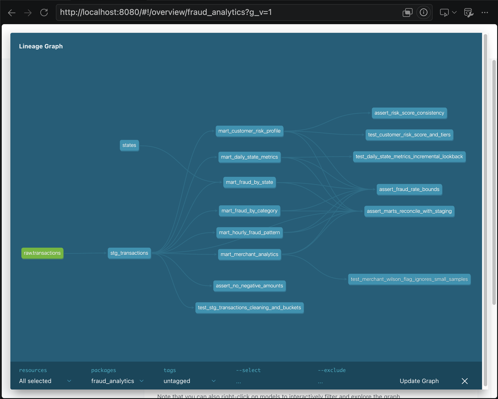

# ДЗ 4: dbt-проект над данными о транзакциях

dbt-проект поверх таблицы `hw2.transactions` из домашки по ClickHouse: staging-слой, 6 витрин
по фроду, макросы, ~70 data-тестов, 4 singular и 4 unit-теста, sqlfluff, pre-commit, Makefile.

Версии: `dbt-core 1.12.6`, `dbt-clickhouse 1.10.3`, ClickHouse 24.8, пакеты `dbt_utils 1.4.1`,
`dbt_date 0.21.0`, `dbt_expectations 0.10.10` (форк metaplane), `sqlfluff 4.5.0`.

## Запуск

```bash
cd dbt/
make install   # venv в ../venv + dbt, sqlfluff, pre-commit (нужен python3.12, на 3.14 dbt не ставится)
make load      # docker compose up + DDL из hw2 + заливка data/train.csv напрямую в hw2.transactions
make all       # dbt deps && dbt seed && dbt run && dbt test
make docs-serve
make lint      # sqlfluff
make help      # все цели
```

`data/train.csv` по-прежнему нужно положить руками (в git его нет, см. корневой README).
`make load` грузит csv в ClickHouse за ~2 секунды, минуя Kafka; Kafka-путь из hw2 остался как был.
У ClickHouse в `docker-compose.yml` теперь есть volume, данные переживают `docker compose down`.

`profiles.yml` лежит в `dbt/` (dbt ищет его в текущем каталоге), параметры подключения можно
переопределить через `CLICKHOUSE_HOST/PORT/USER/PASSWORD`.

## Архитектура

```
source hw2.transactions ─┐
                          ├─> stg_transactions (view) ─┬─> mart_daily_state_metrics   (incremental)
seed states ──────────────┤                            ├─> mart_fraud_by_category
                          │                            ├─> mart_fraud_by_state  <── seed states
                          │                            ├─> mart_customer_risk_profile
                          │                            ├─> mart_hourly_fraud_pattern
                          │                            └─> mart_merchant_analytics
```

ClickHouse-базы: `hw4_staging` (view), `hw4_marts` (таблицы), `hw4_reference` (seed).

DAG из dbt Docs (`make docs-serve` → Lineage Graph), файл [`graph_screenshot.png`](graph_screenshot.png):



В задании источник называется `transactions_db.transactions`, у меня он `hw2.transactions`
(так он назван в hw2) - это задаётся в `models/sources/sources.yml`. В таблице есть и лишние
относительно задания колонки (адрес, город, ZIP, профессия), они пригодились для ключа клиента.

### Staging: `stg_transactions`

- приведение типов, `upper()` для штата и пола, `LowCardinality` для категориальных колонок;
- у **всех** мерчантов в датасете префикс `fraud_` (артефакт генератора, к фроду отношения не имеет) - срезается;
- в источнике нет id, поэтому суррогатные ключи через `dbt_utils.generate_surrogate_key`:
  `transaction_id` (комбинация полей проверена на уникальность: 786 431 из 786 431) и
  `customer_id` = имя + фамилия + улица + ZIP (по одному имени нельзя: 956 пар имён на 965 клиентов);
- `day_of_week` / `day_name` через `dbt_date`, `is_night` через макрос `is_night_hour`,
  `amount_bucket` через макрос `amount_bucket`.

### Витрины

| Витрина | Зерно | Что интересного |
|---|---|---|
| `mart_daily_state_metrics` | дата × штат | **инкрементальная**: `delete_insert` по (дата, штат), пересчитываются только последние `incremental_lookback_days` (3) дня; P95 через `quantile(0.95)` |
| `mart_fraud_by_category` | категория | `fraud_lift` - во сколько раз фрод чаще среднего, ранг |
| `mart_fraud_by_state` | штат | обогащение seed-ом (название, регион и дивизион по Census), доля задетых фродом клиентов |
| `mart_customer_risk_profile` | клиент | **композитный risk score 0-100** и тир HIGH/MEDIUM/LOW |
| `mart_hourly_fraud_pattern` | день недели × час | флаг окна повышенного риска (fraud rate ≥ 2× среднего) |
| `mart_merchant_analytics` | мерчант | **флаг подозрительности по нижней границе Уилсона** |

**Risk score** = 100 × (0.5 × fraud + 0.3 × amount + 0.2 × night), каждая компонента в [0, 1]:

- `fraud` = min(fraud_rate / 2%, 1);
- `amount` = средний перцентиль клиента по среднему и по максимальному чеку;
- `night` = перцентиль клиента по доле ночных (22:00-04:00) транзакций.

HIGH ≥ 60, MEDIUM ≥ 35. Веса, порог насыщения и границы тиров - dbt vars в `dbt_project.yml`
(если веса не дают в сумме 1, модель падает на компиляции). При весах по умолчанию клиент без
фрода набирает максимум 50, т.е. HIGH всегда означает подтверждённый фрод + нетипичное поведение.
Компоненты выбраны по данным: ночью фрод в 15-25 раз чаще, чем днём (1.4-2.8% против ~0.1%),
в транзакциях от $200 - 8-24% против 0.03-0.3%.

**Подозрительный мерчант** - если даже нижняя граница 95% доверительного интервала Уилсона для его
fraud rate выше общего fraud rate (0.57%). В отличие от правила "rate > k × среднего", это не
срабатывает на мелких мерчантах с 1 фродом из 2 транзакций, зато ловит крупных с умеренно, но
устойчиво повышенным уровнем. Это и проверяет unit-тест.

### Макросы (`macros/`)

- `amount_bucket(col, cutoffs=none)` - бакеты micro / small / medium / large / very_large по
  фиксированным границам $10 / $50 / $200 / $1000 (переопределяются аргументом или var);
- `rate_pct(num, den)` - процент с защитой от деления на 0;
- `wilson_lower_bound(successes, trials, z)` - нижняя граница интервала Уилсона;
- `is_night_hour(hour)` - попадание часа в ночное окно с переходом через полночь.

## Тесты

`dbt build` - 89 узлов: 1 seed, 7 моделей, 77 data-тестов, 4 unit-теста, всё PASS.
Лог успешного `dbt test` (81 тест: 77 data + 4 unit) - [`dbt_test.log`](dbt_test.log).

- **Generic (73)**: `not_null` (28), `unique` (7), `accepted_values` (11), `relationships` на seed штатов (3),
  `dbt_utils.unique_combination_of_columns` на составные ключи витрин (2), `dbt_expectations` (22):
  диапазоны всех процентов, часов, дней недели, координат, компонент скоринга; число категорий = 14;
  168 строк в почасовой витрине; число строк staging = источнику; fraud rate ≥ нижней границы Уилсона.
- **Singular (4)** в `tests/`:
  - `assert_no_negative_amounts`;
  - `assert_fraud_rate_bounds` - fraud_rate_pct ∈ [0, 100] сразу во всех 6 витринах;
  - `assert_marts_reconcile_with_staging` - сумма `txn_count` и `fraud_count` в каждой витрине
    совпадает со staging (ловит потерю строк в join-ах и дубли в инкрементальной витрине);
  - `assert_risk_score_consistency` - score ∈ [0, 100], тир соответствует score, нет HIGH без фрода.
- **Unit (4)**, `models/*/unit_tests.yml`:
  - `test_stg_transactions_cleaning_and_buckets` - срез префикса, границы бакетов (10 → small,
    200 → large, 1000 → very_large) и ночного окна (03:59 - ночь, 04:00 - нет), ISO-день недели;
  - `test_merchant_wilson_flag_ignores_small_samples` - 1/2 при среднем 25% не флаг, 4/5 - флаг;
  - `test_customer_risk_score_and_tiers` - три клиента → 100 / 50 / 0 → HIGH / MEDIUM / LOW;
  - `test_daily_state_metrics_incremental_lookback` - в инкрементальном режиме старые даты не пересчитываются.

  Каждый unit-тест проверен на "ломание": при изменении ожидаемого значения падает.

## Линтинг и pre-commit

`.sqlfluff` и `.pre-commit-config.yaml` лежат **в корне репозитория**, а не в `dbt/`, как в примере
задания: pre-commit читает конфиг только из корня, а sqlfluff берёт `templater` только из конфига
в каталоге запуска. Шаблонизатор - `dbt` (компилирует проект, поэтому видит макросы и `ref`),
диалект `clickhouse`. Исключены CP03 (camelCase-функции ClickHouse) и ST06; на трёх строках с
параметрическими агрегатами (`quantile(0.95)(x)`, `topK(1)(x)`) стоит `-- noqa: LT01`, их
диалект sqlfluff не понимает.

```bash
make -C dbt precommit-install   # git-хуки
make -C dbt precommit           # pre-commit run --all-files
```

Хуки: trailing-whitespace, end-of-file-fixer, check-yaml, check-added-large-files, sqlfluff-lint,
sqlfluff-fix. Для sqlfluff нужен запущенный ClickHouse.

## Что видно в данных

- Fraud rate 0.57% (4 504 из 786 431). Топ категорий: `shopping_net` 1.72% (lift 3.0),
  `misc_net` 1.44%, `grocery_pos` 1.40%.
- Все 40 окон повышенного риска из 168 приходятся на 22:00-03:59.
- 147 из 693 мерчантов подозрительны по Уилсону.
- Клиенты: 220 HIGH, 302 MEDIUM, 443 LOW.
- DE на первом месте по fraud rate со 100%, но там один клиент - для этого в витрине штатов
  есть `unique_customers`.
