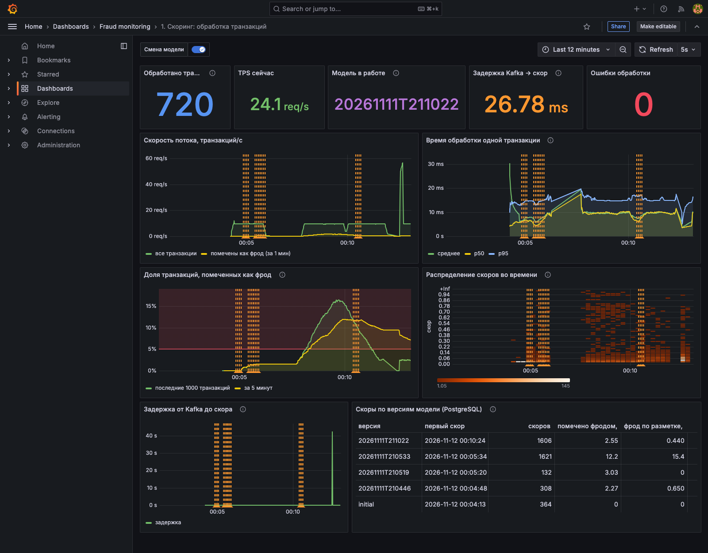
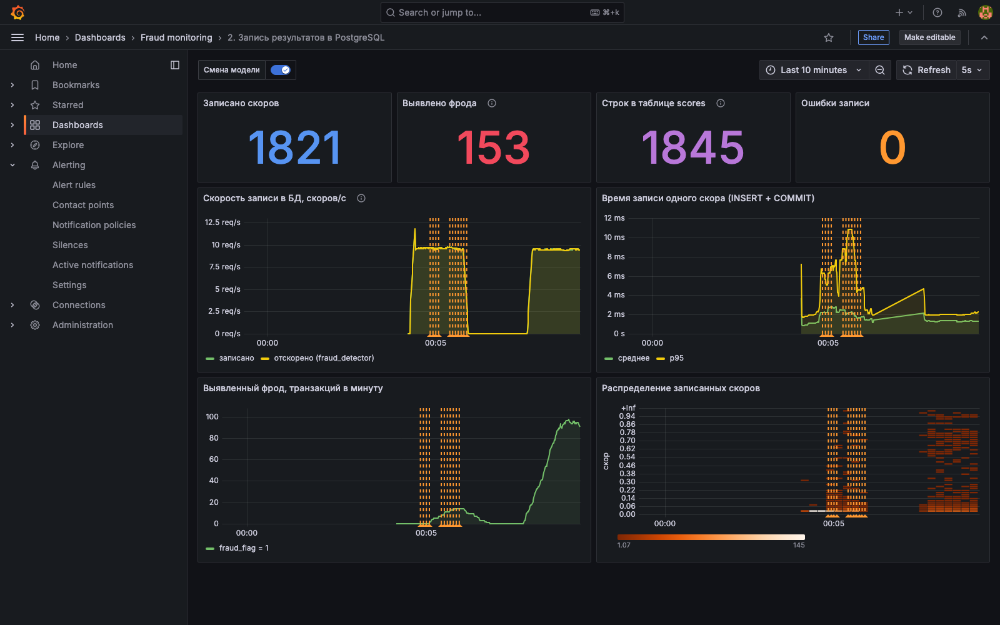
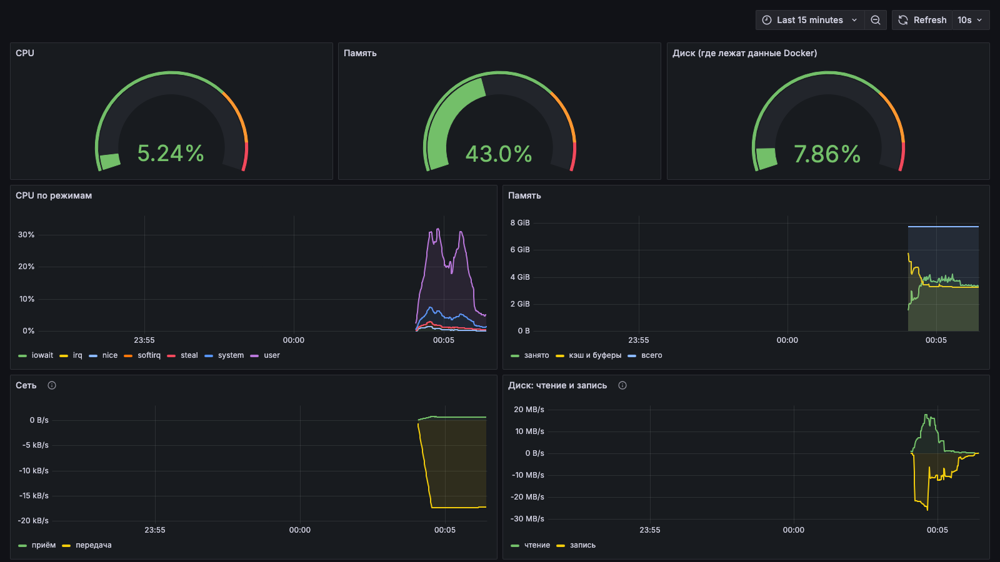
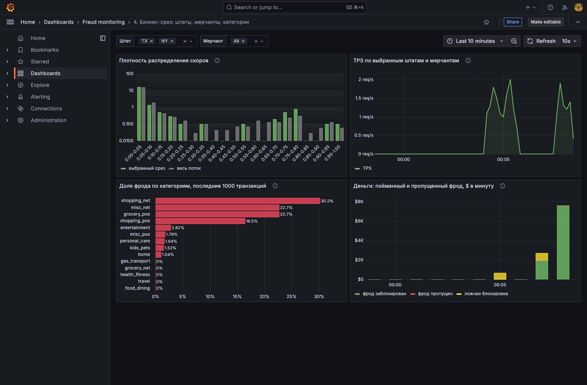
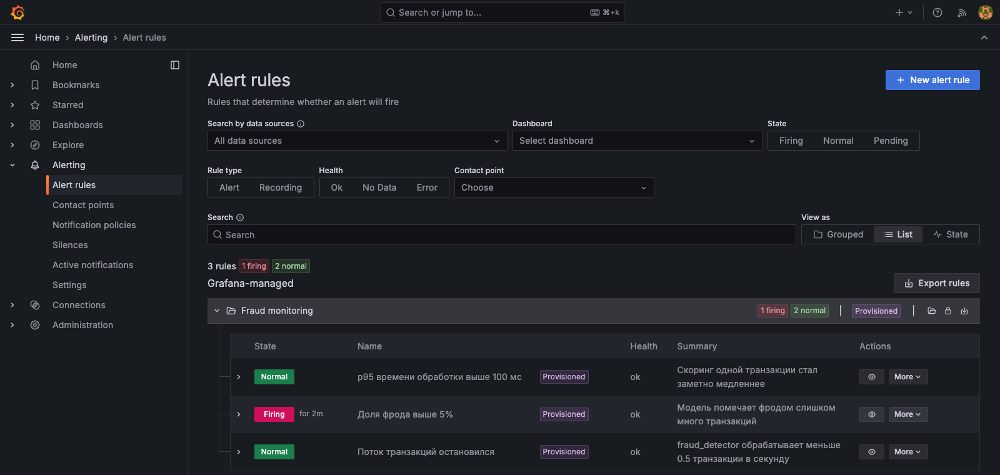

# ДЗ 5: мониторинг скоринга фрода (Prometheus + Grafana)

За основу взят код семинара [mlops_realtime_fraud_detector_monitoring](https://github.com/NikitaMalykhin/mlops_realtime_fraud_detector_monitoring):
симулятор шлёт транзакции в Kafka, `fraud_detector` скорит их CatBoost-ом, `scoring_writer` пишет скоры
в PostgreSQL, Airflow каждые 5 минут переобучает модель и публикует новую версию, которую скоринг
подхватывает без перезапуска. Первый коммит ветки - код семинара как есть, дальше мои изменения:
[дифф относительно семинара](https://github.com/polozkovdmitry/ipii-mlops-hw2-kh-polozkov/compare/8651f22...hw5-monitoring).

Поверх этого: свои метрики в обоих сервисах, 4 дашборда и 3 алерта, которые лежат в репозитории и
появляются при старте, источник PostgreSQL в Grafana со срезами по версии модели, штатам, мерчантам и
категориям.

## Запуск

Нужен Docker с Compose v2 и примерно 6 ГБ памяти для Docker. Свободные порты: 3000, 5432, 8000, 8001,
8081, 8082, 9090, 9095.

```bash
# train.csv должен лежать в data/ в корне репозитория (как в ДЗ 2, в git его нет)
cd monitoring
docker compose up -d --build
```

`.env` не нужен: у всех переменных в `docker-compose.yml` есть значения по умолчанию, `train.csv` берётся
из `../data/train.csv`. Если файл лежит в другом месте - `cp .env.example .env` и поправить `TRAIN_DATA_CSV`.

Первый запуск занимает несколько минут, в основном скачивание и сборка образов (Airflow, CatBoost).
Потом `data_loader` за несколько секунд грузит CSV в PostgreSQL, скоринг стартует сразу, не дожидаясь загрузки.

| Что | Адрес | Логин |
|---|---|---|
| **Grafana** | http://localhost:3000 | `admin` / `admin` (смену пароля можно пропустить, Skip) |
| **Prometheus** | http://localhost:9090 (Status → Targets: 3 цели в UP) | - |
| Метрики скоринга | http://localhost:8000/metrics | - |
| Метрики записи в БД | http://localhost:8001/metrics | - |
| Airflow | http://localhost:8081 | `admin` / `admin` |
| Kafka UI | http://localhost:8082 (у семинара 8080, у меня этот порт занят) | - |
| PostgreSQL | `localhost:5432`, база `fraud_db` | `fraud_user` / `fraud_pass` |

Остановить: `docker compose down`, с удалением всех данных (витрина, модели, история метрик): `docker compose down -v`.

## Дашборды

Grafana → Dashboards → папка **Fraud monitoring**. Первый дашборд открывается и как домашняя страница.
Datasource-ы (Prometheus и PostgreSQL), дашборды и алерты подключаются через provisioning
(`grafana/provisioning/`, `grafana/dashboards/`), руками ничего настраивать не надо.

**1. Скоринг: обработка транзакций** (`fraud-scorer`) - `fraud_detector`:
- плитки: сколько транзакций обработано, текущий TPS, **какая модель сейчас в работе**, задержка Kafka → скор, ошибки;
- скорость потока (все транзакции и помеченные фродом);
- время обработки транзакции: среднее, p50, p95;
- доля фрода: по последним 1000 транзакциям и за 5 минут, красная линия - порог алерта;
- heatmap скоров во времени;
- задержка от Kafka до скора (моя метрика, см. ниже);
- таблица из PostgreSQL: сколько скоров посчитала каждая версия модели, доля фрода, средний скор;
- **отметка смены модели**: оранжевая область ~20 секунд с подписью версии на всех графиках.



На скриншоте по порядку: старт на модели `initial` и три смены модели подряд (оранжевые отметки), остановка
симулятора (TPS упал в 0, сработал алерт), запуск с `FRAUD_BOOST=0.2` (доля фрода ушла выше красной линии 5%,
второй алерт), ещё одна смена модели по расписанию, возврат к обычному потоку и перезапуск `fraud_detector` на 30 секунд
(пик на графике задержки и всплеск TPS, пока разбиралась очередь). Счётчики после перезапуска начались с нуля,
это нормально для Prometheus, `rate()` такие сбросы учитывает.

**2. Запись результатов в PostgreSQL** (`scoring-writer`) - `scoring_writer`: записано скоров (по счётчику и
`count(*)` из таблицы для сверки), выявленный фрод, скорость записи рядом со скоростью скоринга (видно,
если writer отстаёт), время записи (среднее и p95), фрод в минуту, heatmap записанных скоров. Смена модели
отмечается так же.



**3. Системные метрики (Node Exporter)** (`node-system`): CPU / память / диск сейчас, CPU по режимам, память,
сеть, чтение и запись диска. На маке Docker работает в виртуалке, поэтому это метрики виртуалки Docker Desktop,
а не самого мака. Диск берётся тот, где лежат данные Docker: `/` на Linux, `/var/lib/docker` в Docker Desktop.



**4. Бизнес-срез: штаты, мерчанты, категории** (`fraud-business`) - всё из PostgreSQL, сверху фильтры
**Штат** и **Мерчант** (мультивыбор, список мерчантов зависит от выбранных штатов):
- плотность распределения скоров для выбранного среза и, серым, для всего потока;
- TPS по выбранным штатам и мерчантам;
- barplot: доля фрода по `cat_id` среди последних 1000 транзакций;
- свой график - **деньги: пойманный и пропущенный фрод, $ в минуту** (см. ниже).



## Метрики

`fraud_detector`, порт 8000, обновляются на каждом обработанном сообщении:

| Метрика | Тип | Что это |
|---|---|---|
| `scorer_transactions_total` | counter | обработанные транзакции |
| `scorer_fraud_flagged_total` | counter | из них помечены как фрод (score > 0.5) |
| `scorer_processing_seconds` | histogram | время обработки одной транзакции: препроцессинг + инференс + отправка в Kafka |
| `scorer_score` | histogram | распределение скоров, бакеты по 0.02 |
| `scorer_fraud_ratio` | gauge | доля фрода среди **последних 1000** транзакций |
| `scorer_event_lag_seconds` | gauge | **новая**: задержка от записи транзакции в Kafka до скора |
| `scorer_model_info{version}` | gauge | **новая**: версия модели, которая работает сейчас (=1) |
| `scorer_errors_total` | counter | **новая**: сообщения, упавшие при обработке |
| `scorer_model_switches_total{version}` | counter | +1 при подхвате новой модели без перезапуска |

`scoring_writer`, порт 8001: `writer_scores_written_total` (записано скоров), `writer_db_write_seconds`
(histogram, INSERT + COMMIT), `writer_fraud_flagged_total` (записано с флагом фрода), `writer_score`
(histogram записанных скоров), `writer_errors_total`.

Node Exporter: стандартные `node_cpu_seconds_total`, `node_memory_*`, `node_network_*`, `node_disk_*`, `node_filesystem_*`.

Отличия от семинара:

- **`scorer_event_lag_seconds`** - главная метрика, которой не было. Время обработки показывает, сколько
  занимает одно сообщение, но не видит очередь: если скоринг перестал успевать за потоком (или лежал и
  поднялся), сообщения копятся в Kafka, время обработки остаётся ~10 мс, а транзакции получают скор через
  минуты. Считается как `сейчас - timestamp сообщения в Kafka`. Смотреть на дашборде 1: плитка
  «Задержка Kafka → скор» и график «Задержка от Kafka до скора». В норме 10-20 мс. Проверял так:
  `docker compose stop fraud_detector`, 30 секунд паузы, `docker compose start fraud_detector`. На графике
  пик ~45 с (пауза + старт контейнера), и через пару секунд снова миллисекунды: скоринг сам может делать
  больше 50 транзакций/с при потоке 10/с, поэтому очередь из ~400 сообщений разбирается за несколько секунд
  (на графике TPS в этот момент виден всплеск). Если бы модель была тяжелее и не успевала,
  задержка бы росла непрерывно, при этом время обработки одной транзакции оставалось бы прежним.
- `scorer_model_info` - чтобы на дашборде было видно, какая версия работает **сейчас**, а не только моменты смен.
- `scorer_errors_total` / `writer_errors_total` - раньше ошибки только писались в лог.
- Время обработки и записи - `Histogram`, а не `Summary`: из Summary нельзя посчитать квантили в Prometheus, а p95 нужен для алерта.
- `scorer_fraud_ratio` считается по скользящему окну 1000 транзакций, а не с момента старта. Накопленная
  доля через час работы почти не двигается, и алерт на ней бесполезен.

### Изменения в сервисах

- `fraud_detector` кроме `transaction_id`, `score`, `fraud_flag` и `model_version` отправляет в топик `scoring`
  ещё `us_state`, `merch`, `cat_id`, `amount` и `target` из исходной транзакции, а `scoring_writer` пишет их в
  `scores` - это нужно для фильтров по штатам и мерчантам. Старые поля не тронуты, контракт скоринга тот же.
- `target` есть, потому что симулятор берёт строки из `train.csv` с разметкой. В реальности разметка
  приходит позже, но для демонстрации так можно сравнить решения модели с правдой.
- Логи «Prediction complete» на каждое сообщение переведены в debug, иначе они 10 раз в секунду забивали лог.
- У симулятора есть `FRAUD_BOOST` - доля транзакций, которые берутся только из фродовых строк. Нужен для проверки алерта.
- В compose: версии образов зафиксированы вместо `latest`, `.env` не обязателен, сервисы перезапускаются при падении.

## Как проверить

**Метрики растут с потоком.** Через минуту после старта:

```bash
curl -s localhost:8000/metrics | grep -E '^scorer_(transactions_total|fraud_ratio|event_lag)'
sleep 5
curl -s localhost:8000/metrics | grep -E '^scorer_transactions_total'   # выросло на ~50
curl -s localhost:8001/metrics | grep -E '^writer_scores_written_total'
```

В Prometheus (http://localhost:9090) запрос `rate(scorer_transactions_total[30s])` даёт ~10 транзакций/с
(симулятор шлёт раз в 0.1 с). На дашбордах 1 и 2 графики обновляются каждые 5 секунд.

У меня в среднем: обработка транзакции ~10 мс (p95 ~15 мс), запись в БД ~2 мс, задержка Kafka → скор 10-20 мс.

**Отметка смены модели.** DAG `retrain_catboost` запускается сам каждые 5 минут, но можно не ждать:

```bash
docker compose exec airflow airflow dags trigger retrain_catboost
# через ~1-2 минуты:
docker compose exec airflow cat /opt/airflow/models/latest.txt
docker compose logs fraud_detector | grep "Модель сменилась"
```

(или кнопка Trigger в Airflow UI). Переобучение занимает ~30-40 секунд. После публикации на дашборде
скоринга появляется оранжевая отметка с версией (`Новая модель` / `20261111T210446`, при наведении),
меняется плитка «Модель в работе», а в таблице версий появляется новая строка. Сразу после первого старта
DAG тоже запускается сам, так что первая смена `initial` → новая версия видна через минуту-две и без ручного запуска.

Как сделана отметка: при первом сообщении после смены `latest.txt` сервис делает
`scorer_model_switches_total{version="<новая>"}.inc()`. Аннотация в Grafana - запрос
`scorer_model_switches_total unless scorer_model_switches_total offset 20s`: серия с новой версией
уже есть, а 20 секунд назад её не было, поэтому отметка держится 20 секунд. Модель, с которой
контейнер стартовал, сменой не считается, чтобы рестарт не давал ложную отметку.

## Алерты

Правила в `grafana/provisioning/alerting/rules.yaml`, видны в Grafana → Alerting → Alert rules, папка Fraud
monitoring. Проверяются каждые 10 секунд. Доставки (почта, телеграм) нет, состояние смотрится там же.

| Алерт | Условие | Сколько держится | Как проверить |
|---|---|---|---|
| Поток транзакций остановился | `sum(rate(scorer_transactions_total[30s])) < 0.5` или метрик нет вообще | 30 с | `docker compose stop transaction_simulator`, через ~1 минуту Firing; `docker compose start transaction_simulator` - снова Normal |
| Доля фрода выше 5% | `scorer_fraud_ratio > 0.05` (последние 1000 транзакций) | 20 с | `FRAUD_BOOST=0.2 docker compose up -d transaction_simulator`, через 1-2 минуты Firing; вернуть: `docker compose up -d transaction_simulator` |
| p95 времени обработки выше 100 мс | `histogram_quantile(0.95, ...[1m]) > 0.1` | 1 мин | в норме p95 ~ мс, сработает при перегрузке CPU |

Порог 5% выбран по живому потоку: переобученные модели помечают 2-3% транзакций (`initial` из образа -
почти 0), в разметке фрода ~0.6%. 5% - это уже аномалия: атака или сломавшаяся модель. С `FRAUD_BOOST=0.2`
доля поднимается до 10-14% и алерт срабатывает примерно через минуту.

Оба проверяемых алерта я прогнал: остановка симулятора → «Поток остановился» в Firing через ~70 секунд и
обратно в Normal после старта; `FRAUD_BOOST=0.2` → «Доля фрода выше 5%» в Firing:



## Срез из PostgreSQL

Datasource PostgreSQL (`uid: postgres`) подключается из `grafana/provisioning/datasources/datasources.yaml`
к той же базе `fraud_db`. Таблица `scores` (создаёт `scoring_writer`):

| Поле | Тип | |
|---|---|---|
| id | BIGSERIAL | |
| transaction_id | TEXT | |
| score | DOUBLE PRECISION | |
| fraud_flag | SMALLINT | score > 0.5 |
| model_version | TEXT | версия модели, которая посчитала скор |
| us_state, merch, cat_id, amount | | из транзакции, для срезов |
| target | SMALLINT | разметка из train.csv |
| created_at | TIMESTAMPTZ | время записи, индекс |

Панели:
- **«Скоры по версиям модели»** (дашборд 1) - `GROUP BY model_version`: число скоров, когда версия работала, доля
  фрода по флагу и по разметке. Рядом с графиками Prometheus, так что на одном экране видно и что поток жив, и какая модель что насчитала.
- **Фильтры по штату и мерчанту** (дашборд 4) - переменные `$state` и `$merch` из `SELECT DISTINCT ... FROM scores`,
  на них отфильтрованы плотность скоров и TPS.
- **Barplot по `cat_id`** - подзапрос `ORDER BY id DESC LIMIT 1000`, потом среднее `fraud_flag` по категории.
- **Свой график: деньги, $ в минуту** - сумма `amount` по трём исходам: фрод заблокирован (flag=1, target=1),
  фрод пропущен (flag=0, target=1), ложная блокировка честной транзакции (flag=1, target=0). Для бизнеса
  важна не доля фрода, а деньги: сколько модель сэкономила, сколько пропустила и скольким честным клиентам
  помешала. Этот график тоже фильтруется по штату и мерчанту, и по нему видно, как меняется картина после смены модели.

## Структура

```
monitoring/
├── docker-compose.yml
├── fraud_detector/        # скоринг + метрики :8000
├── scoring_writer/        # запись в PostgreSQL + метрики :8001
├── transaction_simulator/ # поток в Kafka (+ FRAUD_BOOST)
├── data_loader/, airflow/, dags/, pipeline/   # переобучение, без изменений с семинара
├── prometheus/prometheus.yml                  # 3 цели, scrape_interval 1s
├── screenshots/                               # картинки для README
└── grafana/
    ├── provisioning/datasources/datasources.yaml  # Prometheus + PostgreSQL
    ├── provisioning/dashboards/dashboards.yaml
    ├── provisioning/alerting/rules.yaml           # 3 алерта
    └── dashboards/                                # 4 дашборда
```
